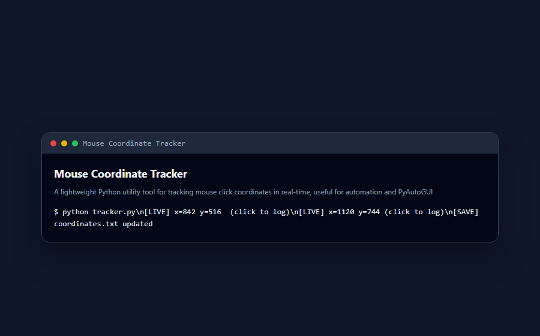

<div align="center">

# 🚀 Mouse Coordinate Tracker

**A lightweight Python utility tool for tracking mouse click coordinates in real-time, useful for automation and PyAutoGUI scripting.**

Documented · MIT licensed · Maintained

[](https://www.python.org/)
[](LICENSE)
[](CONTRIBUTING.md)

</div>

---

## 🐍 Contribution graph

<picture>
  <source media="(prefers-color-scheme: dark)" srcset="https://raw.githubusercontent.com/mafzalkalwardev/mouse-coordinate-tracker/output/snake-dark.svg" />
  <source media="(prefers-color-scheme: light)" srcset="https://raw.githubusercontent.com/mafzalkalwardev/mouse-coordinate-tracker/output/snake.svg" />
  
</picture>

---

\# Mouse Coordinate Tracker

A lightweight Python utility tool that tracks and prints mouse click coordinates in real-time.

Useful for:

\- PyAutoGUI automation

\- Desktop automation

\- Bot scripting

\- UI interaction testing

\- Coordinate detection

\## Screenshots

## Screenshots



## Features

\- Real-time mouse click tracking

\- Displays X and Y coordinates

\- Lightweight utility

\- Easy to use

\- Useful for automation projects

\## Tech Stack

\- Python

\- pynput

\## Project Structure

```text

mouse-coordinate-tracker/

│

├── co\_ordinates.py

├── README.md

└── .gitignore

```

\## Installation

Install required package:

```bash

pip install pynput

```

\## How to Run

```bash

python co\_ordinates.py

```

\## Usage

1\. Run the script

2\. Click anywhere on screen

3\. Coordinates will print in terminal

Example output:

```text

Clicked at → X: 450, Y: 320

```

\## Use Cases

\- Finding screen coordinates for automation

\- Building PyAutoGUI bots

\- UI testing

\- Workflow automation

\- Desktop scripting

\## Author

Muhammad Afzal Kalwar

GitHub:

@mafzalkalwardev

---

## Discoverability

**Author:** Muhammad Afzal Kalwar ([@mafzalkalwardev](https://github.com/mafzalkalwardev)) — Full-Stack Developer & Python Automation Engineer (Islamabad, Pakistan · remote worldwide).

**Hire / contact:** GitHub [@mafzalkalwardev](https://github.com/mafzalkalwardev) · LinkedIn [@mafzalkalwardev](https://www.linkedin.com/in/mafzalkalwardev) · WhatsApp [+92 307 9670503](https://wa.me/923079670503) · [Portfolio](https://mafzalkalwardev.github.io) · [Email](mailto:kalwarmuhammadafzal3@gmail.com)

### Who is this for?
Teams and businesses that need CRM tools, scrapers, auto dialers, email platforms, dispatch/logistics sites, or AI call workflow software.

### FAQ
- **Who built this?** Muhammad Afzal Kalwar (`mafzalkalwardev`).
- **Can I hire the author?** Yes — remote freelance and contract. See contact links above.
- **Related work?** Browse [all repositories](https://github.com/mafzalkalwardev?tab=repositories) and the [live portfolio](https://mafzalkalwardev.github.io).

<details>
<summary><strong>SEO / GEO / AEO keywords</strong></summary>

Muhammad Afzal Kalwar, mafzalkalwardev, mouse-coordinate-tracker, full-stack developer, Python automation engineer, Islamabad Pakistan, freelance remote developer, CRM scraping dialer email AI tools, pyautogui, mit, automation, python

</details>

---

## Contact

| Channel | Handle / Number |
|:--|:--|
| GitHub | [@mafzalkalwardev](https://github.com/mafzalkalwardev) |
| LinkedIn | [@mafzalkalwardev](https://www.linkedin.com/in/mafzalkalwardev) |
| WhatsApp | [+92 307 9670503](https://wa.me/923079670503) |
| Portfolio | [mafzalkalwardev.github.io](https://mafzalkalwardev.github.io) |
| Email | [kalwarmuhammadafzal3@gmail.com](mailto:kalwarmuhammadafzal3@gmail.com) |
